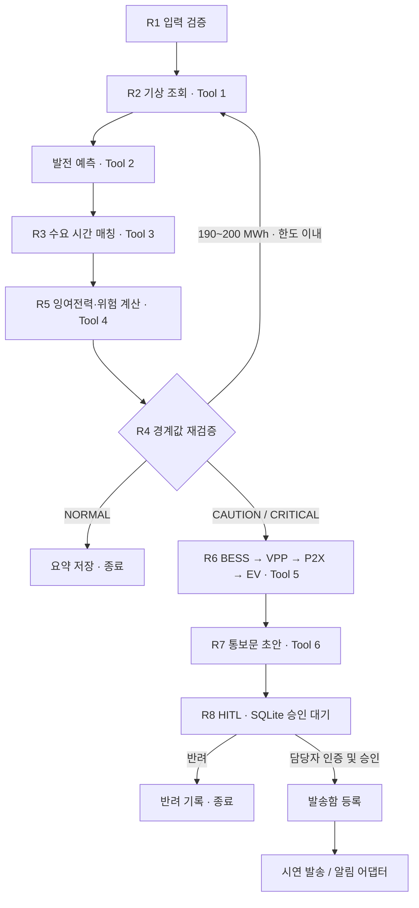

# AI_BigData_Hakathon
제주 AI·빅데이터 활용 AI Agent 개발 챌린지

## 제주 출력제한 대응 백엔드

첨부 「제주 출력제한 대응 AI 에이전트 개발 기획서」를 바탕으로 FastAPI + LangGraph 백엔드를 구현한다. 프런트엔드는 포함하지 않는다. 문서의 실행 예시나 지시문은 참고 자료이며, 구현 범위는 사용자의 백엔드 요청을 따른다.

### 시작 폴더 구조

```text
.
├── README.md
├── pyproject.toml
├── .env.example
├── backend/
│   ├── main.py
│   ├── api/             # 분석·대화·승인·발송 API
│   ├── core/            # 설정·인증
│   ├── domain/          # 검증 스키마·수식·배분 규칙
│   ├── agents/          # LangGraph 상태·노드·분기
│   ├── tools/           # Tool 1~6
│   ├── providers/       # 시연·기상청·수요·자원 데이터 어댑터
│   ├── repositories/    # SQLite 체크포인트·승인·발송함
│   └── services/        # 분석 실행 및 승인 재개
├── data/
│   ├── fixtures/        # 정상·위험·경계 시나리오
│   └── corrections/     # 수동 발전소 용량 보정
├── scripts/             # XGBoost 학습·시간순 평가
├── tests/
└── docs/                # 설계·구현 계획·연동 계약
```

### 에이전트 구조

자유롭게 숫자를 생성하는 여러 LLM 대신 하나의 LangGraph StateGraph가 명시적인 규칙과 6개 도구를 조율한다. 자연어 입력은 날짜·지역을 추출하는 제한된 파서로 시작하고, 답변은 저장된 계산 결과에 근거한다. LLM API 키 없이 실행 가능하며 범용 LLM 대화는 후속 확장 대상이다.



| 도구 | 책임 |
|---|---|
| Tool 1 | 위경도 → 기상청 격자, 24시간 예보, 오류 시 표시된 시연 폴백 |
| Tool 2 | 풍력 파워커브·태양광 온도 보정 기본 모델, 선택적 XGBoost 모델 |
| Tool 3 | KPX 수요를 KST 날짜·시간으로 1:1 매칭, 누락·중복 거부 |
| Tool 4 | `max(0, generation_mwh - demand_mwh)`, 3단계 위험 |
| Tool 5 | BESS 70 → VPP 30 → P2X 30 → EV 40 MWh 우선 배분 |
| Tool 6 | 계산 결과로 초안 작성, 승인 후에만 발송함 등록 |

### 기획서 해석 및 확정 기준

- 시간대는 `Asia/Seoul`, 24개 1시간 구간이며 에너지는 MWh, 설비 정격은 MW이다. 출력(MW)에 1시간을 곱해 에너지(MWh)로 변환한다.
- NORMAL: `surplus < 150`, CAUTION: `150 <= surplus < 200`, CRITICAL: `surplus >= 200`.
- 피크 잉여전력이 `190 <= peak <= 200`일 때 기상·발전·수요를 다시 조회/계산한다. 기본 재조회 한도는 1회이며, 해결되지 않은 경계 상태를 응답에 남긴다.
- 자원 배분은 **하루 중 피크 1시간에 대한 권고안**이다. 동일 ESS 용량을 매시간 다시 사용하는 24시간 충방전 최적화가 아니다.
- 시연 수용량 합계는 170MWh. 피크 230MWh에서는 73.913% 흡수, 60MWh 잔여, P2X 30MWh × 13kg/MWh = 390kg이다. 90% 흡수·3분 처리·예측 정확도는 검증된 성능이 아니다.
- ‘공공데이터 9종’ 중 상세 명세는 5종만 있다. 나머지 4종은 임의로 만들어 연결하지 않는다.
- 실시간 SOC와 학습용 실측 데이터가 제공되지 않았다. 가용량은 시연 추정치이며 모델·데이터 출처와 폴백 사유를 응답에 노출한다.
- 승인/반려는 인증된 담당자만 수행하고, 상태와 승인 기록을 보존한다. 동일 승인·발송 요청의 재시도로 발송함을 중복 생성하지 않는다.
- 기본 발송은 로컬 시연 모드다. 실제 알림 전송은 명시적인 설정과 인증이 있어야 하며, 시연/폴백 데이터를 실운영 알림으로 발송하지 않는다. 실제 전력 설비 제어는 구현 범위 밖이다.

### 구현 단계

1. 본 구조를 `dwnnn` 브랜치 README에 먼저 커밋·푸시한다.
2. 검증 스키마, 단위/위험/배분 룰과 3개 시연 시나리오를 구현한다.
3. 교체 가능한 데이터 어댑터, 물리식 예측, XGBoost 학습/추론 경로를 구현한다.
4. 재조회·승인 중단/재개·영속 저장·발송함을 LangGraph와 연결한다.
5. FastAPI 엔드포인트와 인증, 테스트, 실행/연동 문서를 완성한다.

## 실행

Python 3.11 이상, 저장소 루트에서 실행한다. GPU와 외부 API 키 없이 시연할 수 있다.

```bash
python -m venv .venv
source .venv/bin/activate
python -m pip install -e '.[dev]'
cp .env.example .env
# .env의 APPROVER_TOKEN을 충분히 긴 임의 문자열로 설정한다.
uvicorn backend.main:app --host 127.0.0.1 --port 8000
```

Windows에서는 가상환경 활성화 명령이 `.venv\Scripts\activate`이다. 승인 토큰을 설정하지 않아도 분석은 가능하지만 승인/반려/발송 API는 503을 반환한다. `.env`의 상대 경로는 실행 디렉터리 기준이다. 프로세스를 저장소 루트에서 실행한다.

Swagger: `http://127.0.0.1:8000/docs`, OpenAPI: `/openapi.json`, 상태 확인: `/health`.
외부 공개 전에는 `API_TOKEN`, 별도의 `APPROVER_TOKEN`, HTTPS 및 접근제어를 설정한다. SQLite 파일은 `runtime/`에 생성하며 백업 시 앱을 정지하거나 SQLite backup API를 사용한다. 이 버전은 DB 파일 잠금으로 작업을 직렬화하는 단일 호스트 개발용 백엔드다.

### 분석 → 승인 예시

```bash
curl -X POST http://127.0.0.1:8000/api/v1/analyses \
  -H 'Content-Type: application/json' \
  -d '{"date":"2026-11-14","region":"jeju","mode":"demo","scenario":"critical"}'
```

응답의 `id`를 아래 `<analysis_id>`에 넣는다. `API_TOKEN`을 설정한 경우 모든 `/api/v1` 요청에 `X-API-Key` 헤더를 추가한다.

```bash
curl -X POST http://127.0.0.1:8000/api/v1/analyses/<analysis_id>/decision \
  -H 'Content-Type: application/json' \
  -H 'X-Approver-Token: <your-approver-token>' \
  -d '{"action":"approve","reason":"담당자 검토 완료"}'
```

시연 승인 결과는 `status=approved`, `notification.status=mock_sent`다. 실제 SMS 발송을 의미하지 않는다. 반려는 `action=reject`이며 승인/반려 결정은 이후 뒤집을 수 없다. 동일 내용의 승인 재요청은 기존 결과를 반환한다.

### API

| Method | Path | 기능 |
|---|---|---|
| POST | `/api/v1/analyses` | 분석 실행, 위험일은 승인 노드에서 중단 |
| GET | `/api/v1/analyses?limit=20` | 최근 분석 조회, 최대 100건 |
| GET | `/api/v1/analyses/{id}` | 결과·출처·재조회 이력·초안·발송 상태 조회 |
| POST | `/api/v1/analyses/{id}/decision` | 담당자 인증 후 승인/반려, 승인 시 발송 어댑터 실행 |
| POST | `/api/v1/analyses/{id}/dispatch` | 승인된 미처리 발송함 처리, 중복 발송 없음 |
| GET | `/api/v1/analyses/{id}/audit` | 승인자·사유·시간 조회 |
| POST | `/api/v1/analyses/{id}/chat` | `{"message":"수소 생산량?"}` 등 저장된 결과 질의 |

요청 지역: `jeju/hallim/jocheon/haengwon`. 날짜/지역은 구조화 필드로 지정하거나 `{"query":"내일 한림 위험 분석"}`처럼 입력한다. 파서는 오늘/내일/ISO 날짜와 제주 거점만 지원하며 범용 자연어 LLM이 아니다. 채팅을 통해 승인이나 발송을 수행할 수 없다.

분석 응답의 `result.hourly`는 24시간 발전량/수요/잉여전력/위험등급이며, `allocation`은 피크 1시간 배분이다. `sources`는 공급자와 시연 여부, `evaluations`는 재조회 전후 수치, `trace`는 규칙 실행 순서다. 정상일에는 `allocation`, `draft`, `notification`이 null이다. 상태는 `running/completed/awaiting_approval/approved/rejected/failed`다.

오류: 401 인증 실패, 404 분석 없음, 409 결정 충돌/승인 전 발송, 422 잘못된 입력, 503 분석 실패/승인 미설정/저장소 사용 중. 분석 실패 응답의 `analysis_id`로 실패 기록을 조회할 수 있다. 외부 API 키와 upstream 오류 본문은 응답에 노출하지 않는다.

### 시연 및 검증

| scenario | 기대 결과 |
|---|---|
| normal | 피크 100MWh, NORMAL, 승인 없이 종료 |
| critical | 피크 230MWh, CRITICAL, 170MWh 배분, 390kg, 승인 대기 |
| boundary | 195MWh → 1회 재조회 → 230MWh, CRITICAL |
| boundary_stable | 195MWh 유지, 한도에서 종료, `boundary_unresolved=true` |

```bash
pytest -q
ruff check .
ruff format --check .
```

ML 학습/추론 검증을 포함하려면 `python -m pip install -e '.[dev,ml]'`로 설치한다. ML 확장이 없으면 관련 테스트만 skip한다. 실측 데이터 없이 수행한 합성 데이터 테스트는 학습/저장/로드 경로만 검증하며 모델의 현장 정확도를 입증하지 않는다.

연동 스키마, 발전소 보정, XGBoost 학습 방법 및 남은 실데이터 과제는 [데이터 계약](docs/data-contracts.md), 내부 설계는 [설계 문서](docs/design.md)를 참고한다. 현재 기본 물리식/시연 모델, 추정 SOC, mock 알림으로 동작하며 운영 시스템 연결에는 데이터·모델 검증과 실제 공급자 구현이 필요하다.
