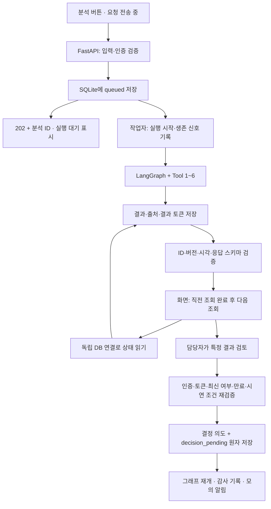
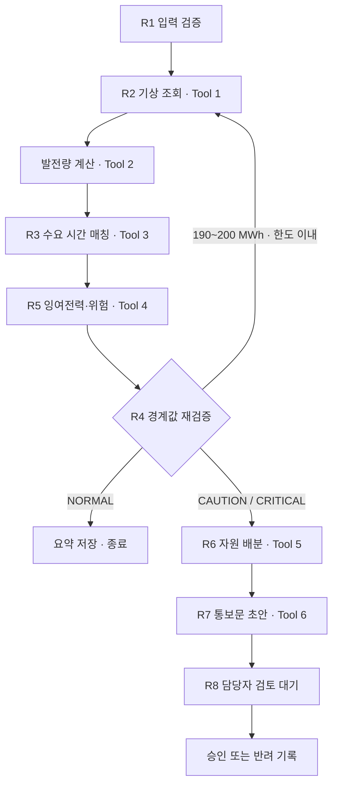

# 제주 에너지 예측·검토 에이전트

FastAPI/LangGraph 백엔드와 React/TypeScript 프론트엔드로 구성한 출력제한 대응 의사결정 지원 프로젝트입니다. **화면 탐색은 즉시 처리하고, 분석·승인 상태는 서버에서 확인한 사실만 표시합니다.**

현재 기본 실행은 고정 시나리오를 사용하는 **시연**입니다. 실제 설비 제어는 없으며, 시연 승인은 모의 알림만 기록합니다. 전날 실측 데이터의 시차 특성을 학습해 다음날 발전량을 예측하는 회귀 파이프라인은 아직 구현하지 않았습니다. 기존 선택적 XGBoost 경로는 같은 시간의 기상·설비 특성 회귀이며, 현장 예측 정확도는 검증되지 않았습니다.

## 폴더 구조

```text
.
├── README.md                    # 프로젝트 입구: 실행·구조·제약
├── DESIGN.md                    # 색상·타이포·레이아웃 기준
├── UX-CONTRACT.md               # 상태·승인·접근성 공통 동작
├── backend/
│   ├── README.md                # 서버 읽는 순서와 API 예시
│   ├── pyproject.toml / uv.lock # Python 의존성
│   ├── .env.example
│   ├── app/
│   │   ├── main.py              # FastAPI 및 worker 생명주기
│   │   ├── api/                 # HTTP 요청·응답
│   │   ├── core/                # 설정·인증
│   │   ├── domain/              # 데이터 검증·수식·위험 규칙
│   │   ├── agents/              # LangGraph 노드·분기
│   │   ├── tools/               # Tool 1~6
│   │   ├── providers/           # 기상·수요·알림 어댑터
│   │   ├── repositories/       # SQLite 작업·결정·체크포인트
│   │   └── services/            # 접수·실행·복구·승인
│   ├── data/                   # 시연 fixture·수동 보정
│   ├── scripts/                # 선택적 XGBoost 학습
│   └── tests/                  # 서버 통합·규칙·복구 테스트
├── frontend/
│   ├── README.md
│   ├── package.json / package-lock.json
│   ├── src/
│   │   ├── app/                # 메뉴와 화면 조립
│   │   ├── api/                # 통신·인증·응답 검증
│   │   ├── components/         # Button·Modal·StatusBadge
│   │   ├── features/
│   │   │   ├── analysis/       # 입력·차트·상태 관리
│   │   │   ├── allocation/     # 피크 1시간 배분안
│   │   │   ├── approval/       # 결과에 묶인 담당자 결정
│   │   │   └── history/        # 분석 이력
│   │   ├── pages/              # 화면 구성
│   │   ├── styles/             # 토큰·공통 스타일
│   │   └── test/               # 공통 테스트 준비·데이터
│   └── tests/                  # Playwright 브라우저 테스트
└── docs/
    ├── architecture/           # 현재 실행 계약·원본 에이전트 설계
    ├── guides/                 # 학습 순서·데이터 연동
    ├── verification/           # 검증 결과·화면 증거
    └── archive/                # 이전 버전 계획·검증 기록
```

기능에 관한 코드는 `features/기능명`, 여러 기능에서 사용하는 작은 UI는 `components/`에 둡니다. 서버에서는 HTTP(`api`) → 업무 흐름(`services`) → 계산(`agents/tools/domain`) → 저장·외부 연동(`repositories/providers`) 순서로 읽습니다. 과거 문서는 `archive`에 보존하되 현재 실행 안내와 구분했습니다.

## 실행

Python 3.11 이상, Node.js 22, uv를 권장합니다. 두 터미널에서 각각 실행합니다.

```bash
# 터미널 1 — 저장소 루트에서
cd backend
uv sync --frozen --extra dev --extra ml
cp .env.example .env
# backend/.env의 APPROVER_TOKEN에 직접 만든 별도의 인증 토큰을 설정
uv run uvicorn app.main:app --host 127.0.0.1 --port 8000
```

```bash
# 터미널 2 — 저장소 루트에서
cd frontend
npm ci
npm run dev
```

화면: `http://localhost:5173` · API 문서: `http://localhost:8000/docs`

GPU·외부 API 키 없이 시연 분석이 가능합니다. 승인 토큰을 설정하지 않으면 승인/반려가 차단됩니다. `API_TOKEN`을 설정한 경우 화면의 **연결 설정**에도 API 키를 입력합니다. API 키는 새로고침하면 지워지며 담당자 토큰은 검토 창에서만 사용합니다. `.env`와 SQLite 파일은 Git에 저장하지 않습니다.

백엔드는 반드시 `backend/`에서 실행합니다. 이전 버전의 `.env`, `runtime/`, `models/`가 루트에 있다면 서버를 정지하고 백업한 뒤 `backend/` 아래로 옮기거나 절대 경로를 설정합니다. 구버전 분석 기록은 조회 전용으로 복구합니다. 개발 중에는 프론트엔드 Vite가 `/api`를 백엔드로 전달합니다. 배포 시에는 같은 출처의 역방향 프록시와 접근제어를 별도로 구성해야 합니다.

## 기본 실행 구조



`queued`는 접수 완료, `running`은 작업자의 실행 시작 확인입니다. 응답 유실은 실패로 단정하지 않고 **상태 확인 불가**로 표시합니다. 재요청은 같은 UUID를 사용해 중복 작업을 막습니다. 조회는 긴 계산 잠금을 기다리지 않습니다. `/health`는 프로세스 응답, `/ready`는 작업자 스레드 생존과 최근 DB 오류 상태를 확인합니다.

## 에이전트 내부 구조



LangGraph가 명시적인 계산·분기 규칙을 실행합니다. LLM이 발전량이나 위험 수치를 생성하지 않으며 LLM API 키도 필요하지 않습니다. 기존 제한형 질의 API는 저장된 결과에 근거해 답하고 상태를 변경하지 않습니다.

- 시간대 `Asia/Seoul`, 하루 24개의 1시간 구간, 에너지 단위 MWh.
- 잉여전력 `max(0, 발전량 - 수요)`. NORMAL `<150`, CAUTION `150 이상 200 미만`, CRITICAL `200 이상`.
- 피크 `190~200 MWh`는 기본 1회 재조회. 경계가 해소되지 않으면 승인을 막습니다.
- 배분은 **피크 1시간**만 대상으로 BESS 70 → VPP 30 → P2X 30 → EV 40 MWh 순서입니다. 24시간 ESS 운전 최적화가 아닙니다.
- 위험일 시연: 피크 230 MWh → 흡수 170 MWh(73.913%) → 잔여 60 MWh, 수소 환산 390 kg.
- 외부 조회 실패 시 시연 데이터로 바꾸는 폴백은 기본 꺼져 있습니다. live 결과는 모델·가용량이 미검증이므로 승인과 실제 발송을 차단합니다.
- 같은 날짜·지역·모드의 새 작업이 접수되면 이전 결과의 신규 승인을 막습니다. 기본 검토 유효시간은 완료 후 60분입니다.
- 승인 기록, 모의 알림 기록, 실제 설비 동작은 서로 다릅니다. 이 버전에는 실제 저장·출력제한 명령 경로가 없습니다.

## 검증과 학습

```bash
# backend/에서
uv run pytest -q
uv run ruff check .
uv run ruff format --check .

# frontend/에서
npm test
npm run build
npm run format:check
npx playwright install chromium
npm run test:e2e
```

브라우저 테스트는 서버를 자동으로 띄우며 로컬에서 이미 실행 중이면 재사용합니다. 재사용 서버의 승인 토큰은 테스트용 `local-review-test`여야 합니다. 실제 계정·운영 DB와 분리된 로컬 시연 환경에서 실행합니다.

- [변경 내용과 공부 순서](docs/guides/learning-guide.md)
- [백엔드/API 안내](backend/README.md) · [프론트엔드 안내](frontend/README.md)
- [상태·승인 실행 계약](docs/architecture/execution-contract.md)
- [데이터 연동·기존 회귀 모델 계약](docs/guides/data-contracts.md)
- [검증 기록](docs/verification/current.md)

현재 구성은 단일 호스트 SQLite 작업 큐입니다. 여러 서버에 걸친 작업 분산, 실제 관측 데이터의 품질 검증, 전날 데이터 기반 다음날 예측 학습과 운영 평가, 현장 자원 상태 검증은 후속 구현 대상입니다.
